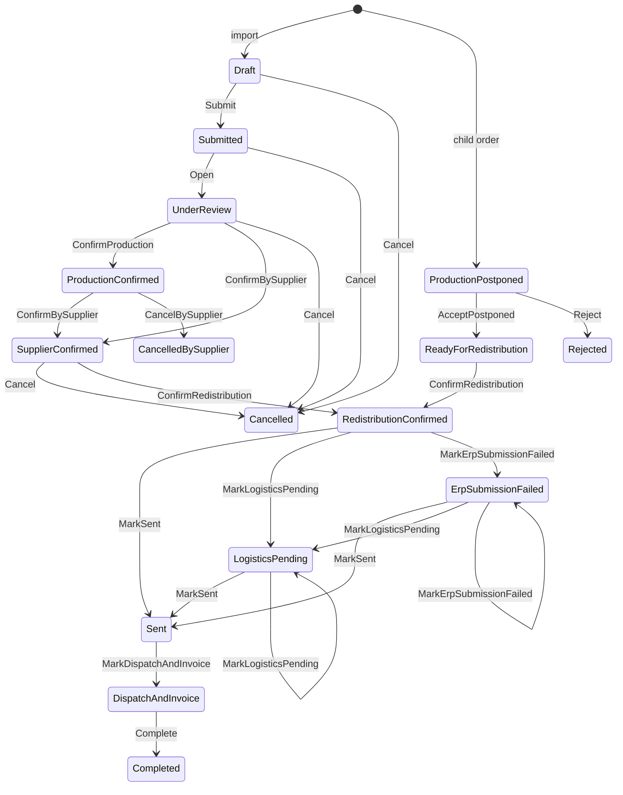

# Stockline API

A .NET 10 backend for **supplier purchase-order management**: a buyer imports an order from an Excel template, the
supplier reviews and confirms what it can produce, the buyer redistributes the confirmed quantities across warehouses
and stores, and the system creates the purchase order and the store transfer requests in the ERP.

It is a clean-room re-implementation of the business logic of a larger Python system, redesigned around an explicit
domain model. See [docs/LEGACY_PARITY.md](docs/LEGACY_PARITY.md) for a feature-by-feature comparison with the original.

## Highlights

- **Explicit order state machine** — 16 statuses, 14 actions, 4 roles; every transition is a data row, covered by tests.
- **Excel in and out** — validated import (with dry run and a downloadable validation log), re-importable export,
  margin / differences / transfers / ERP-integration workbooks, purchase-order PDF.
- **Supplier flow** — quantities and costs can be changed while reviewing; confirming less than requested forces the
  buyer to acknowledge the difference or split it into **child orders** (`PO-1.01`, `PO-1.02`).
- **Redistribution** — proportional proposal, saved draft, strict plan validation (totals, locations, duplicates).
- **ERP integration** — Service Layer adapter, **idempotent** per document, master-data pre-check, background
  submission with a retry sweeper for transient failures, full attempt log. Mixed orders produce one purchase order per
  supplying warehouse and one transfer request per store.
- **Role-based data protection** — supplier production never sees costs; only the buyer sees retail prices.
- **Notifications** — Server-Sent Events stream and subscription-based emails (PDF attached when documents are ready).
- **JWT authentication** with refresh tokens, user administration, per-user UI preferences.

## Architecture

```
Stockline.Api             minimal-API endpoints, auth, background workers
Stockline.Application     use cases (handlers), ports, report builders — no framework dependencies
Stockline.Infrastructure  EF Core (SQL Server), ClosedXML, QuestPDF, MailKit, Service Layer HTTP client
Stockline.Domain          entities, state machine, redistribution rules, ERP document planner
tests/Stockline.UnitTests domain, application, persistence (SQLite) and API (WebApplicationFactory) tests
```

Dependencies point inward: `Api → Infrastructure → Application → Domain`. Handlers depend on ports
(`IOrderRepository`, `IErpGateway`, `IEmailSender`, ...) implemented in Infrastructure, so the whole workflow is
testable with in-memory fakes, and the API tests run the real pipeline against SQLite and a fake ERP.

Notable design choices:

| Concern | Decision |
|---|---|
| Concurrency | Optimistic: the order status is an EF concurrency token; a lost race answers `409`. |
| ERP calls | One idempotency key (`U_sap_id`) per document; progress is saved after every call, so a crash or retry never duplicates a document. |
| Failures | The ERP result distinguishes transient (retried automatically, up to 5 times) from permanent (waits for the buyer). |
| Quantities | Requested vs confirmed are separate; the difference is first-class, not inferred. |
| Time | `TimeProvider` everywhere; tests freeze the clock. |
| Secrets | None in the repository: JWT key, ERP password and SMTP password come from configuration / environment. |

## Roles and visibility

| | Buyer | Supplier | Supplier production |
|---|:-:|:-:|:-:|
| Import / submit / cancel / discard orders | ✔ | | |
| Review, edit quantities, comments | | ✔ | ✔ (quantities, comments) |
| Edit costs | | ✔ | |
| Confirm production | | | ✔ |
| Confirm to the buyer, split differences | ✔ | ✔ | |
| Redistribute, submit to the ERP | ✔ | | |
| See costs and discounts | ✔ | ✔ | ✘ |
| See retail price (PVP) and margin | ✔ | ✘ | ✘ |
| Orders visible | all | all | only *Submitted* and *Under review* |

Hidden data is withheld everywhere it could leak: order responses, the template export, reports, the audit log and the
event stream.

## Order lifecycle



`ErpSubmissionFailed` and `LogisticsPending` are retried by the system (`MarkSent` etc. are performed by the internal
`System` role); `GET /orders/{id}/actions` lists what the caller can do right now.

## Running it

Requirements: .NET 10 SDK (see `global.json`), SQL Server (a container is fine), optionally an ERP Service Layer or
simulator for the integration.

```bash
dotnet tool restore
dotnet build

export ConnectionStrings__Default="Server=localhost,1433;Database=stockline;User Id=sa;Password=<password>;TrustServerCertificate=True"
export Jwt__Key="<at least 32 random characters>"
export Erp__BaseUrl="http://localhost:50001/b1s/v1/" Erp__CompanyDb=DEMO Erp__UserName=manager Erp__Password=<password>
export Seed__DemoPassword="<password for the demo users>"      # Development only

dotnet run --project src/Stockline.Api        # applies migrations and seeds demo users in Development
```

Demo users (Development, created only when `Seed:DemoPassword` is set): `admin@`, `buyer@`, `supplier@`,
`production@stockline.test`. Interactive docs: `/openapi/v1.json` in Development; `src/Stockline.Api/Stockline.Api.http`
has ready-made requests.

Migrations live in `src/Stockline.Infrastructure/Persistence/Migrations`:

```bash
dotnet ef migrations add <Name> -p src/Stockline.Infrastructure -s src/Stockline.Api -o Persistence/Migrations
```

### Configuration

| Key | Purpose |
|---|---|
| `ConnectionStrings:Default` | SQL Server connection string |
| `Jwt:Key`, `Issuer`, `Audience`, `AccessTokenMinutes`, `RefreshTokenDays` | token signing and lifetime |
| `Erp:BaseUrl`, `CompanyDb`, `UserName`, `Password`, `TimeoutSeconds` | ERP Service Layer |
| `Erp:PackField`, `Erp:RetailPriceList` | where the ERP keeps a product's pack and retail price |
| `ErpBackground:MaxAttempts`, `RetryIntervalSeconds` | automatic retry of transient ERP failures |
| `Email:Host`, `Port`, `UseStartTls`, `User`, `Password`, `From`, `OrderUrlTemplate` | SMTP; with no host, emails are only logged |
| `Company:Name`, `TaxId`, `Address` | buyer details printed on purchase orders |
| `Jobs:WorkerCount`, `PollIntervalMilliseconds`, `LeaseSeconds`, `RetentionDays` | background job workers (see *Scaling*) |
| `RateLimiting:LoginPerMinute` | login throttling per IP |
| `RateLimiting:HeavyConcurrency`, `HeavyQueue` | concurrent workbook / PDF / upload requests per instance, and how many may wait |

## Scaling: background jobs

Slow work never runs inside the request that asked for it. It becomes a row in `background_jobs` and a worker runs it:

| Kind | Work | Key |
|---|---|---|
| `ErpSubmission` | create the purchase orders and transfer requests in the ERP | the order id |
| `OrderImport` | read, validate (optionally against the ERP) and save an uploaded template | none |
| `EmailNotification` | send the e-mails of an order event | none |

Because the queue is the database, no extra infrastructure is needed and any number of instances can run side by side:

- **Atomic claim with a lease.** A worker takes the oldest runnable job with one conditional `UPDATE`; two workers never get the
  same job. While it works it renews the lease; if the instance dies, the lease expires and another worker takes over. A job
  abandoned on its last attempt is failed instead of looping forever.
- **No duplicate work per key.** A request that arrives while an identical job is still waiting joins it; one that arrives while
  the job is running gets its own job that waits for the running one, so the second run sees the newest state.
- **Retries with back-off.** A crash or a transient failure puts the job back with exponential delay until `MaxAttempts`.
- **Progress.** `GET /jobs/{id}` returns status, percent, stage and, when finished, the result (for an import: the outcome,
  the new order id and every validation issue). A job is visible only to its creator and to admins.
- **Heavy requests are bounded.** Workbook and PDF exports and template uploads go through a concurrency limiter per instance;
  extra requests queue and, past the queue, get `429`.

Measured against SQL Server with two instances sharing one database: 40 simultaneous imports were accepted in 0.4 s, finished
in about 3 s, each ran exactly once (22 on one instance, 18 on the other) and produced exactly 40 orders.

## API overview

All routes except `/auth/login`, `/auth/refresh` and `/health` need a bearer token.

| Area | Routes |
|---|---|
| Auth | `POST /auth/login`, `/auth/refresh`, `/auth/logout`, `GET /auth/me` |
| Orders | `GET /orders` (filters: status, search, dates, supplier, creator, modifier, `pendingMyAction`), `GET /orders/{id}`, `DELETE /orders/{id}` (discard), `GET /orders/filters`, `/orders/exists`, `/orders/last-created`, `/orders/last-redistributed` |
| Import / export | `POST /orders/import` (`validateErp`, `requireErp`, `corrections`), `POST /orders/import/async` (same options, answers `202` with a job), `GET /jobs/{id}`, `GET /jobs`, `POST /orders/import/validate` (dry run, `format=xlsx` for the log), `GET /orders/{id}/export`, `/source-file`, `/source-file/info` |
| Lifecycle | `GET /orders/{id}/actions`, `POST /orders/{id}/actions/{action}`, `GET /orders/{id}/audit-log` |
| Supplier | `PATCH /orders/{id}/lines/{sku}/confirmed-quantity` · `/cost` · `/comment`, `GET /orders/{id}/difference`, `POST /orders/{id}/confirm` |
| Redistribution | `GET /orders/{id}/redistribution`, `/redistribution/proposal`, `PUT …/draft`, `POST …/confirm` |
| ERP | `POST/GET /orders/{id}/erp-submission`, `GET …/export`, `GET /orders/{id}/erp-documents/{doc}/pdf`, `PUT /orders/{id}/lines/{sku}/product-code`, `GET /erp/documents`, `/erp/attempts`, `/erp/items` |
| Reports | `GET /orders/{id}/reports/margin` · `/differences` · `/transfers` |
| Catalog | `GET /locations`, `GET/POST/PATCH /admin/locations` |
| Notifications | `GET /notifications/stream` (SSE), `/admin/notifications/topics` · `/subscriptions` · `/status` |
| Other | `GET /dashboard/summary`, `/users/me/preferences`, `/admin/users`, `/admin/roles`, `GET /health` |

## Tests

```bash
dotnet test
```

400+ tests, no external services needed: domain rules, handlers with in-memory fakes, EF Core against SQLite, the Service
Layer adapter against a scripted HTTP server, Excel round-trips, PDF rendering and the full HTTP pipeline. Two classes of
bug only showed up against the real SQL Server and ERP (EF owned-entity sharing, Service Layer's case-sensitive login
body); both have regression tests.
